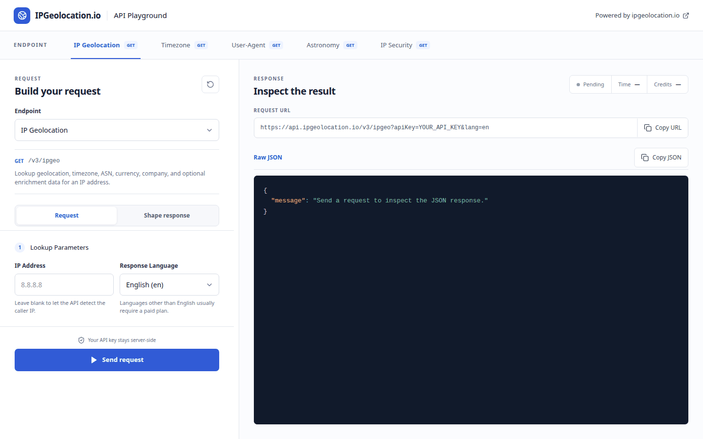

# IP Geolocation API Playground

A public, open-source playground for building and testing IPGeolocation.io API requests without exposing an API key in browser-side code.

Choose an endpoint, configure its supported parameters, optionally shape the response, send the request through the protected Next.js proxy, and inspect the upstream Raw JSON response alongside its status, response time, and credit usage.

This project is powered by the [IPGeolocation.io API](https://ipgeolocation.io/documentation.html).

## Demo



<details>
<summary>View static screenshot</summary>


</details>

## Features

- Test IP Geolocation, Timezone, User-Agent, Astronomy, and IP Security endpoints
- Build requests with endpoint-specific fields and sensible defaults
- Select optional modules and response fields where supported
- Preview the complete request URL with the API key masked
- Inspect syntax-highlighted Raw JSON responses
- View the upstream HTTP status, request duration, and credits charged
- Copy the masked request URL or complete JSON response
- Keep the `IPGEOLOCATION_API_KEY` on the server
- Independently scroll long request forms and JSON responses on desktop
- Use a responsive layout on desktop, tablet, and mobile

## Supported endpoints

| Tool | Endpoint | Purpose |
| --- | --- | --- |
| IP Geolocation | `GET /v3/ipgeo` | Location, country, ASN, currency, timezone, and optional enrichment data |
| Timezone | `GET /v3/timezone` | Timezone and local-time data from a name, address, coordinates, airport code, or IP |
| User-Agent | `GET /v3/user-agent` | Browser, operating system, engine, and device parsing |
| Astronomy | `GET /v3/astronomy` | Sunrise, sunset, moon phase, and related location-based astronomy data |
| IP Security | `GET /v3/security` | VPN, proxy, Tor, bot, spam, relay, cloud-provider, and threat signals |

Endpoint availability, optional fields, localization, and credit costs depend on the IPGeolocation.io subscription attached to the configured API key. Check the current [API documentation](https://ipgeolocation.io/documentation.html) and [pricing](https://ipgeolocation.io/pricing.html) before deploying publicly.

## Get an IPGeolocation.io API key

1. Open the [IPGeolocation.io signup page](https://ipgeolocation.io/signup).
2. Create an account or sign in.
3. Copy the API key from the IPGeolocation.io dashboard.
4. Add it to this project's `.env` file:

   ```env
   IPGEOLOCATION_API_KEY=your_api_key_here
   ```

## Run locally

### Requirements

- Node.js 20.9 or newer
- npm
- An IPGeolocation.io API key

### Installation

1. Clone the repository and enter the project directory:

   ```bash
   git clone https://github.com/Abdullah-Afzal178/ip-geolocation-api-playground.git
   cd ip-geolocation-api-playground
   ```

2. Install dependencies:

   ```bash
   npm install
   ```

3. Create a local environment file:

   ```bash
   cp .env.example .env
   ```

4. Replace the placeholder in `.env` with your API key:

   ```env
   IPGEOLOCATION_API_KEY=your_api_key_here
   ```

5. Start the development server:

   ```bash
   npm run dev
   ```

6. Open [http://localhost:3000](http://localhost:3000).

## Environment variables

| Variable | Required | Description |
| --- | --- | --- |
| `IPGEOLOCATION_API_KEY` | Yes | Secret key used only by the server-side proxy route |
| `NEXT_PUBLIC_SITE_URL` | No | Canonical deployment URL used by metadata, `robots.txt`, and the sitemap |

Never place the API key in a variable prefixed with `NEXT_PUBLIC_`. Next.js includes those values in browser-side JavaScript.

## How it works

1. The user selects one of the five configured API tools.
2. The playground loads the fields and defaults defined for that endpoint.
3. The user enters lookup values and optionally adjusts response-shaping options.
4. The browser sends the endpoint ID and parameters to `POST /api/playground`.
5. The server validates the endpoint, removes empty values, and adds `IPGEOLOCATION_API_KEY`.
6. The server performs the upstream request to `api.ipgeolocation.io`.
7. The playground displays the Raw JSON body, HTTP status, elapsed time, and selected response headers.

The real API key is never returned to the browser. URLs shown in the interface replace it with `YOUR_API_KEY`.

## Production build

Create and run an optimized production build locally:

```bash
npm run build
npm start
```

Run the TypeScript check separately with:

```bash
npm run typecheck
```

## Deploy your own copy

The project can run on any platform that supports Next.js and protected server-side environment variables.

### Vercel

1. Fork the repository or push your copy to GitHub.
2. Import the repository into [Vercel](https://vercel.com/new).
3. Add `IPGEOLOCATION_API_KEY` to the project environment variables.
4. Optionally set `NEXT_PUBLIC_SITE_URL` to the production URL.
5. Deploy.

The same setup works on services such as Netlify, Railway, Render, or a self-hosted Node.js server.

## Project structure

```text
ip-geolocation-api-playground/
├── app/
│   ├── api/playground/route.ts   # Protected IPGeolocation.io proxy
│   ├── globals.css               # Application and responsive styles
│   ├── layout.tsx                # Metadata and root layout
│   ├── page.tsx                  # Main route
│   ├── robots.ts                 # robots.txt generation
│   └── sitemap.ts                # Sitemap generation
├── components/
│   └── playground.tsx            # Request builder and Raw JSON viewer
├── lib/
│   ├── api-config.ts             # Endpoint definitions and request construction
│   └── site.ts                   # Canonical site URL
├── public/                       # Demo media, favicon, and Open Graph image
├── .env.example                  # Environment-variable template
├── next.config.ts                # Next.js configuration
└── package.json                  # Scripts and dependencies
```

## Security and usage notes

- The API key is read only by the server route and is not exposed in browser JavaScript.
- The playground does not store requests or API responses in a database.
- Each successful upstream request may consume API credits.
- Public deployments should add rate limiting, access controls, or both to protect the configured account quota.
- The server accepts only endpoint IDs defined in `lib/api-config.ts`; users cannot choose an arbitrary upstream URL.
- Upstream validation and subscription errors are returned in the JSON viewer.

## API errors

Common causes of unsuccessful responses include:

- Missing or invalid API key
- Invalid IP address, coordinates, timezone, date, or location input
- Unsupported parameter combinations
- Subscription restrictions for an endpoint or optional module
- Exhausted credits or rate limits
- Temporary upstream connectivity problems

Refer to the [official IPGeolocation.io documentation](https://ipgeolocation.io/documentation.html) for current parameters, response fields, eligibility, and credit usage.

## Contributing

Issues and pull requests are welcome. Before opening a pull request, run:

```bash
npm run typecheck
npm run build
```

## Acknowledgements

- [IPGeolocation.io](https://ipgeolocation.io) for the API platform
- [Next.js](https://nextjs.org) and [React](https://react.dev) for the application framework
- [Tailwind CSS](https://tailwindcss.com) for the styling toolchain
- [PrismJS](https://prismjs.com) for JSON syntax highlighting
- [Lucide](https://lucide.dev) for interface icons

---

Built with the [IPGeolocation.io API](https://ipgeolocation.io/documentation.html).
